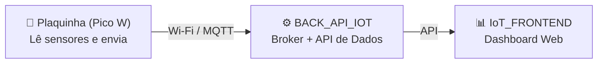

# Mini estação Meteorológica (Raspberry Pi Pico W)

Bem-vindo ao repositório da **nossa mini estação meteorológica**! 🌦️🚀

É aqui que mora o código em **MicroPython** que roda direto no **Raspberry Pi Pico W** (na placa **BitDogLab**). O trabalho dele é simples, mas essencial: ler o clima ao redor em tempo real, mostrar tudo na telinha da placa e mandar esses dados pela internet sem deixar nada se perder pelo caminho.

---

## 🧩 Como tudo se conecta?

Nosso projeto de **IoT e Big Data** foi dividido em 3 partes que trabalham juntas:

1. **📡 A Plaquinha (Você está aqui! — `IOT-Definitivo`)**  
   É o código que alimenta o Raspberry Pi Pico W. Ele lê os sensores de clima, cuida da telinha OLED, dos LEDs, do som e dispara os dados via Wi-Fi.
2. **⚙️ O Servidor e Broker ([BACK_API_IOT](https://github.com/Kaique-Barbosa/BACK_API_IOT/tree/master))**  
   É a ponte entre a placa e a web! Ele recebe todas as mensagens da estação (funcionando como *Broker MQTT*), organiza os dados e responde pela API.
3. **📊 O Visual Bonitão ([IoT_FRONTEND](https://github.com/zHacker7z/IoT_FRONTEND))**  
   É o nosso frontend! Pega os dados lá da API e transforma em gráficos e painéis bem mais agradáveis de acompanhar.

---

## ✨ O que essa estação faz na prática?

* **🌡️ Fica de olho no clima:** Mede temperatura (fazendo até uma média entre dois sensores pra ficar mais esperto), umidade do ar, pressão atmosférica e se está chovendo.
* **🛡️ Não perde dados se o Wi-Fi cair:** Se a internet sumir, a placa guarda as leituras na memória dela mesma e acende os **LEDs vermelhos da matriz 5×5** pra te avisar que tem coisa acumulada. Assim que a rede volta, ela descarrega tudo automático!
* **📺 Tem 4 telinhas no display OLED (Botão B):**
  * **Clima:** Resumo rápido com status do Wi-Fi/Broker, hora, temperatura, umidade e chuva.
  * **Dados Técnicos:** Pressão em hPa, altitude aproximada e temperatura de cada sensor separado.
  * **Sistema:** Qual Wi-Fi está conectado, IP da placa, fila e memória livre.
  * **Saídas:** Mostra ao vivo os valores exatos que estão sendo enviados naquele segundo!
* **🔊 Avisa no som:** Um buzzer dá bipes simpáticos quando conecta tudo certinho e solta um alerta se a conexão cair.
* **📱 Configura Wi-Fi pelo celular:** Se ela não achar a rede salva, cria na hora o próprio Wi-Fi (`EstacaoIoT-Config`). É só conectar pelo celular, digitar a rede e a senha nova e pronto — sem precisar mexer no código!
* **🧪 Modo teste (Botão A):** Apertou o botão A, ela finge que caiu a internet pra você testar a fila e os LEDs funcionando ao vivo.

---

## 🔌 O que vai ligado na placa?

* **BMP280** (`GP16` / `GP17`) — Pressão e temperatura
* **DHT11** (`GP18`) — Umidade e temperatura
* **Sensor de Chuva** (`GP28` — ligado no **3.3V**!) — Detecta água/chuva
* **Display OLED** (`GP14` / `GP15`) — Telinha 128×64
* **Matriz de LEDs 5×5** (`GP7`) — Medidor visual de fila offline
* **Buzzer** (`GP21`) — Alertas e confirmações sonoras
* **Botão A** (`GP5`) e **Botão B** (`GP6`) — Teste de queda de rede e troca de telas

---

## 📁 Como o código está organizado

* [`firmware/`](firmware/) — Tudo o que vai para dentro do Raspberry Pi Pico W:
  * [`main.py`](firmware/main.py) — O coração que coordena o loop principal
  * [`config.py`](firmware/config.py) — Onde ficam os dados do Broker MQTT e intervalos
  * [`models/`](firmware/models/) — Leitura dos sensores e controle da fila na memória
  * [`views/`](firmware/views/) — Telas do OLED, matriz de LEDs e buzzer
  * [`controllers/`](firmware/controllers/) — Conexão Wi-Fi, relógio (NTP), envio MQTT e portal web de configuração
* [`documentacao/`](documentacao/) — Nosso [Diário do Projeto](documentacao/DIARIO_DO_PROJETO.md) com o histórico completo de tudo que fomos construindo.

---

## 🚀 Quer colocar pra rodar?

1. Confira no [`firmware/config.py`](firmware/config.py) se o endereço do Broker MQTT (`MQTT_SERVER`) está apontando certinho pro servidor do [BACK_API_IOT](https://github.com/Kaique-Barbosa/BACK_API_IOT/tree/master).
2. Suba o conteúdo da pasta `firmware/` para o seu **Raspberry Pi Pico W** (usando VS Code com MicroPico ou Thonny).
3. Ligue a placa! Se ela não encontrar seu Wi-Fi, conecte na rede **`EstacaoIoT-Config`** (senha `12345678`) e configure pelo navegador.
4. Depois é só acompanhar tudo pela telinha OLED ou direto lá no dashboard do [IoT_FRONTEND](https://github.com/zHacker7z/IoT_FRONTEND)!
