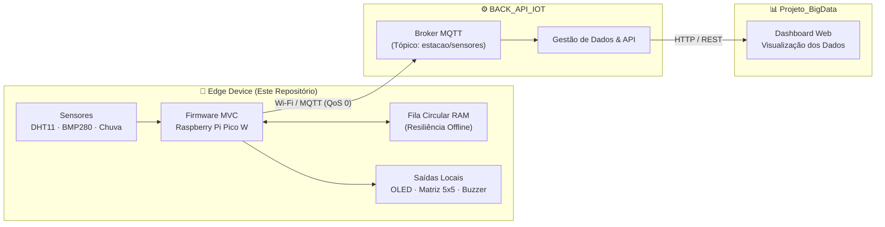

# 🌦️ Miniestação Meteorológica IoT — Edge Firmware (Raspberry Pi Pico W)


Firmware embarcado desenvolvido em **MicroPython** para o **Raspberry Pi Pico W** (placa **BitDogLab v6.3**), atuando como dispositivo de borda (*Edge Device*) de uma miniestação meteorológica IoT.

Este repositório faz parte das disciplinas de **IoT e Big Data** e é o módulo responsável por **alimentar e operar o microcontrolador**: leitura contínua de sensores ambientais, fusão de dados, resiliência offline em RAM, interface física local (OLED, Matriz de LEDs e Buzzer), configuração dinâmica de Wi-Fi via Captive Portal e publicação via MQTT.

---

## 🌐 Ecossistema do Projeto

A solução completa é dividida em três camadas desacopladas, cada uma em seu respectivo repositório:

| Camada | Repositório | Responsabilidade |
| :--- | :--- | :--- |
| 📡 **Edge / Firmware (Este repositório)** | `IOT-Definitivo` | Coleta dos sensores no Raspberry Pi Pico W, fila de resiliência offline, interface física local e envio de telemetria via MQTT. |
| ⚙️ **Backend, Broker & API** | [Kaique-Barbosa/BACK_API_IOT](https://github.com/Kaique-Barbosa/BACK_API_IOT/tree/master) | Servidor backend que também atua como **Broker MQTT**, recebe e gerencia os dados enviados pela estação e disponibiliza a API para consumo. |
| 📊 **Frontend & Visualização** | [zHacker7z/Projeto_BigData](https://github.com/zHacker7z/Projeto_BigData) | Interface web frontend dedicada à visualização gráfica, acompanhamento em tempo real e amostragem dos dados meteorológicos. |



---

## ✨ Principais Funcionalidades

* **Sensoriamento Multivariável e Fusão de Dados:** Coleta temperatura, umidade relativa, pressão atmosférica e nível de chuva, calculando a temperatura combinada pela média entre **DHT11** e **BMP280** com cache de segurança contra falhas pontuais de leitura.
* **Resiliência Offline (Fila Circular FIFO em RAM):** Se o Wi-Fi ou o Broker MQTT caírem, as leituras não são perdidas — elas são armazenadas na fila circular em memória RAM (`queue_manager.py`). Ao restabelecer a conexão, o sistema descarrega automaticamente os registros pendentes em rajadas de até **5 mensagens por ciclo**.
* **Captive Portal Autônomo:** Caso nenhuma rede Wi-Fi salva esteja acessível na inicialização, o Pico W cria automaticamente o Access Point `EstacaoIoT-Config` com servidor HTTP embutido (porta `80`), permitindo configurar SSID e senha pelo celular. As credenciais são validadas em RAM antes de serem gravadas na flash (`credenciais.json`).
* **Display OLED com 4 Telas Interativas (Botão B):**
  * **Tela 0 — Visão Geral:** Status de Wi-Fi (`W:`) e Broker (`B:`), relógio `HH:MM`, temperatura média, umidade e leitura ADC de chuva.
  * **Tela 1 — Dados Técnicos:** Pressão atmosférica em `hPa`, estimativa de altitude barométrica em metros, e leituras individuais do `BMP` e `DHT`.
  * **Tela 2 — Diagnóstico (`[SYSTEM INFO]`):** SSID conectado, endereço IP local, tamanho atual da fila e memória RAM livre.
  * **Tela 3 — Monitor de Saídas (`[SAIDAS]`):** Exibe em tempo real os valores exatos do payload enviado ao broker a cada ciclo, com horário completo `HH:MM:SS`.
* **Feedback Visual e Sonoro Não-Bloqueante:**
  * **Matriz NeoPixel 5x5 (WS2812B):** Permanece apagada quando a fila está vazia e acende progressivamente em vermelho de baixo para cima conforme registros acumulam offline.
  * **Buzzer (PWM):** Emite bipes curtos de confirmação ao conectar no Wi-Fi/MQTT e dispara um alarme sonoro pulsante não-bloqueante de até 10 segundos em quedas de rede.
* **Sincronização NTP (UTC-3):** Ajusta o relógio interno via `ntptime` para carimbar cada registro JSON com data e hora no fuso de Brasília.
* **Simulação de Queda de Rede (Botão A):** Permite simular perda e retorno de conectividade em campo ou laboratório para validar a fila offline e o descarregamento em lote.

---

## 🔌 Hardware e Pinagem (BitDogLab v6.3)

| Componente | Interface | GPIO | Função / Descrição |
| :--- | :--- | :--- | :--- |
| **BMP280** | `I2C0` | `GP16` (SDA) / `GP17` (SCL) | Temperatura e Pressão atmosférica |
| **DHT11** | Digital (`1-Wire`) | `GP18` | Temperatura e Umidade relativa |
| **Sensor de Chuva** | Analógico (`ADC2`) | `GP28` | Leitura analógica de precipitação (alimentado em **3.3V**) |
| **Display OLED SSD1306** | `I2C1` | `GP14` (SDA) / `GP15` (SCL) | Display 128×64 com 4 telas de status |
| **Matriz WS2812B (5×5)** | `NeoPixel` | `GP7` | Barra de preenchimento da fila offline (25 LEDs) |
| **Buzzer A** | `PWM` | `GP21` | Alertas de queda e confirmação de conexão |
| **Botão A** | Digital (`Pull-Up`) | `GP5` | Alterna simulação de queda de Wi-Fi |
| **Botão B** | Digital (`Pull-Up`) | `GP6` | Alterna entre as 4 telas do display OLED |

> [!CAUTION]
> O microcontrolador **RP2040** opera exclusivamente com lógica de **3.3V** nos pinos GPIO/ADC. Alimente o módulo do sensor de chuva sempre no pino **3V3** (nunca em 5V) para evitar danos permanentes ao pino `GP28`.

---

## 📊 Faixa de Métricas dos Sensores

| Sensor | Campo no JSON | Range Operacional | Unidade |
| :--- | :--- | :--- | :--- |
| **DHT11** | `dht_umidade` | `20` a `90` (máx. `95`) | `%` |
| **DHT11** | `dht_temp` | `0` a `50` | `°C` |
| **BMP280** | `bmp_pressao` | `30000` a `110000` (`300` a `1100 hPa`) | `Pa` |
| **BMP280** | `bmp_temp` | `-40.0` a `+85.0` | `°C` |
| **Fusão Térmica** | `temperatura` | `0.0` a `50.0` | `°C` |
| **Sensor de Chuva** | `chuva_bruta` | `~300` (seco) a `65535` (encharcado) | `ADC 16-bit` |

---

## 📁 Estrutura do Repositório

```text
IOT-Definitivo/
├── documentacao/
│   └── DIARIO_DO_PROJETO.md          # Diário técnico e histórico de fases do projeto
├── firmware/
│   ├── config.py                     # Parâmetros de Wi-Fi fallback, Broker MQTT, fila e intervalo
│   ├── main.py                       # Orquestrador principal (loop, botões, fila e publicação)
│   ├── lib/
│   │   ├── bmp280.py                 # Driver I2C do sensor BMP280
│   │   ├── ssd1306.py                # Driver I2C do display OLED SSD1306
│   │   └── umqtt/                    # Cliente MQTT leve (umqtt.simple)
│   ├── models/
│   │   ├── sensors.py                # Leitura dos sensores, cache e fusão térmica
│   │   └── queue_manager.py          # Fila circular FIFO em RAM
│   ├── views/
│   │   ├── display.py                # Renderização das 4 telas do OLED e avisos do portal
│   │   ├── led_matrix.py             # Controle da matriz NeoPixel 5x5
│   │   └── buzzer.py                 # Controle sonoro não-bloqueante via PWM
│   └── controllers/
│       ├── connectivity.py           # Wi-Fi, NTP, MQTT e persistência de credenciais
│       └── portal.py                 # Access Point e servidor HTTP do Captive Portal
└── README.md
```

---

## 📡 Formato do Payload MQTT

As mensagens são publicadas no tópico configurado em `config.py` (padrão: `estacao/sensores`) com `QoS 0` no seguinte formato JSON:

```json
{
  "temperatura": 26.5,
  "dht_temp": 27,
  "dht_umidade": 65,
  "bmp_temp": 26.0,
  "bmp_pressao": 96520.5,
  "chuva_bruta": 312,
  "horario": "2026-10-25 16:06:01"
}
```

---

## 🚀 Como Executar no Raspberry Pi Pico W

1. **Pré-requisitos:**
   * Raspberry Pi Pico W com firmware **MicroPython** instalado (placa BitDogLab v6.3 ou montagem equivalente).
   * IDE **VS Code** com a extensão **MicroPico** (ou **Thonny**).
2. **Configuração:**
   * Ajuste os parâmetros de rede e do broker em [`firmware/config.py`](firmware/config.py):
     * `MQTT_SERVER`, `MQTT_PORT`, `MQTT_CLIENT_ID` e `MQTT_TOPIC` apontando para o servidor do [BACK_API_IOT](https://github.com/Kaique-Barbosa/BACK_API_IOT/tree/master).
     * `FILA_LIMITE` e `INTERVALO_LEITURA` conforme a necessidade de amostragem.
3. **Upload para a placa:**
   * Envie todo o conteúdo da pasta `firmware/` para a memória flash do Raspberry Pi Pico W.
   * Execute ou reinicie a placa para iniciar o `main.py`.
4. **Configuração Wi-Fi pelo Captive Portal (opcional):**
   * Se a rede padrão configurada não estiver disponível, conecte-se pelo celular ou PC à rede Wi-Fi **`EstacaoIoT-Config`** (senha padrão: `12345678`).
   * Acesse o IP exibido no display OLED (ex.: `192.168.4.1`) e informe o SSID e a senha da rede desejada.

---

## 📝 Documentação Complementar

Para acompanhar a evolução técnica, decisões de arquitetura e histórico de marcos do firmware, consulte o [Diário do Projeto](documentacao/DIARIO_DO_PROJETO.md).
